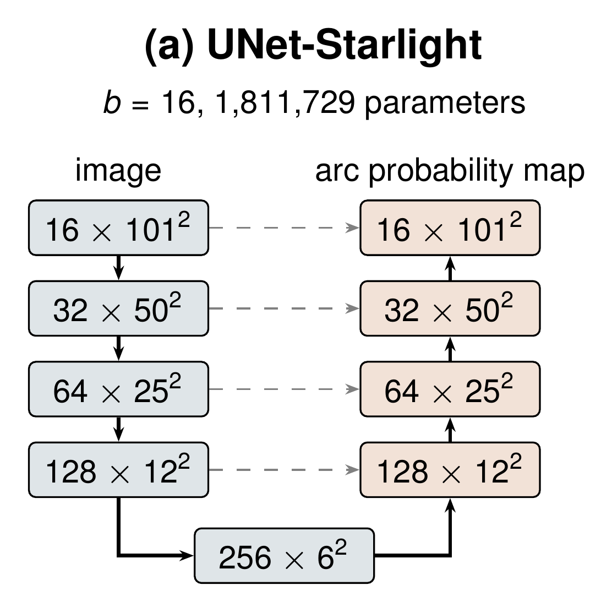

# UNet-Starlight

U-Nets for the discovery of strong gravitational lenses in *Euclid* VIS images, and the code of the experiments of
*EUCLID-SAGE: A Benchmark Suite and U-Net for Strong Gravitational Lens Discovery*. The benchmarks
are in the [EUCLID-SAGE](https://github.com/singularity4/EUCLID-SAGE) repository.



The U-Nets are pretrained on simulated images to segment lensed arcs. The neural networks are then trained to classify the real *Euclid* Q1 stamps of the EUCLID-SAGE
benchmarks. 

UNet-Radius-mini estimates the Einstein radius on the real *Euclid* lenses. Its estimates
are compared with the radii obtained by gravitational lens modelling.

| Model | Filters (first block to bottleneck) | Parameters |
|---|---|---:|
| UNet-Starlight | 16, 32, 64, 128, 256 | 1,811,729 |
| UNet-Starlight-mini | 8, 16, 32, 64, 128 | 453,769 |
| UNet-Starlight-tiny | 4, 8, 16, 32, 64 | 113,861 |
| UNet-Radius-mini | 8, 16, 32, 64, 128 | 453,898 |

## Installation

```bash
git clone https://github.com/singularity4/UNet-Starlight.git
cd UNet-Starlight
pip install -r requirements.txt
```

Tested with Python 3.12. A GPU is used if available.

## Data

- EUCLID-SAGE benchmarks:
  ```bash
  git clone https://github.com/singularity4/EUCLID-SAGE.git ../EUCLID-SAGE
  export EUCLID_SAGE_BENCHMARK_DIR="$(cd ../EUCLID-SAGE/benchmarks && pwd)"
  ```
- `unet_lenses_2000.npz`: the simulated benchmark used in the paper (included).
- `modeling_lens_mass.csv`: measured Einstein radii of the real lenses, from Zenodo record
  [15025832](https://doi.org/10.5281/zenodo.15025832); needed for the Einstein radius experiment.

## Usage

```bash
bash reproduce.sh            # all experiments of the paper
bash reproduce.sh --quick    # short test run
```

| Script | Purpose |
|---|---|
| `simulate.py` | simulated benchmark and second simulated set |
| `train_simulations.py` | training on simulated images |
| `train_benchmarks.py` | lens classification on the EUCLID-SAGE benchmarks |
| `einstein_radius.py` | Einstein radii of the real lenses |
| `paper_results.py` | tables of the paper |
| `data.py`, `unet_models.py`, `model_metrics.py`, `post_training_statistics.py` | shared modules |

Results are written to `results/`. All random seeds are fixed.

## License

MIT

## Acknowledgements

The lenses are from the *Euclid* Q1 Strong Lensing Discovery Engine (Euclid Collaboration: Walmsley et al. 2026,
A&A 711, A26) and the images from the *Euclid* Q1 data release (Euclid Collaboration: Aussel et al. 2026); see the
[Euclid data credits](https://www.cosmos.esa.int/web/euclid/data-credits-acknowledgements). The simulations use [`lenstronomy`](https://github.com/lenstronomy/lenstronomy).
